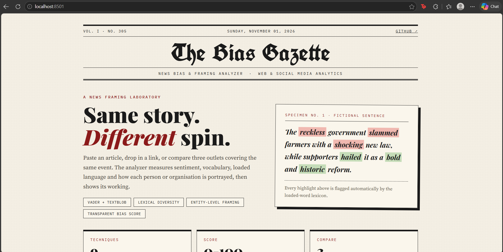
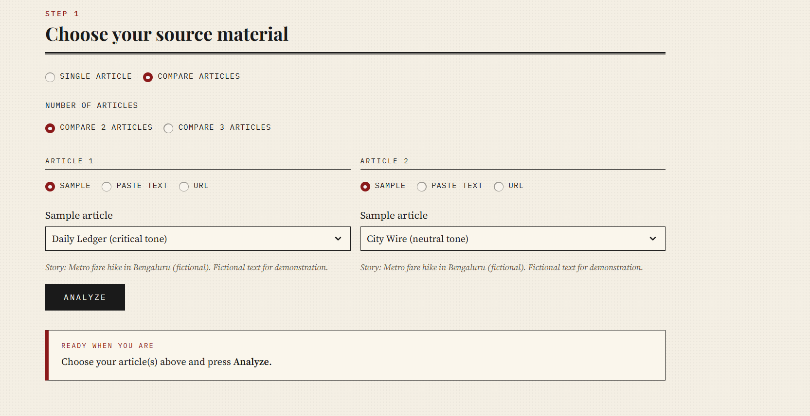

# News Bias & Framing Analyzer

An NLP dashboard that measures *how* a news article is written: its sentiment, vocabulary, loaded language, and how each person or organisation is portrayed. Compare up to three outlets covering the same story side by side.

**Live demo:** _add your Streamlit link here_
**Course:** Web & Social Media Analytics

## Features

- Analyze pasted text, a URL, or built-in sample articles (fictional, so the demo works offline)
- Compare 2-3 articles on the same story
- Sentence-by-sentence sentiment timeline
- Transparent 0-100 bias score with every component shown
- Highlighted loaded, hedging, certainty and stance words
- Entity-level framing: how each person or organisation is portrayed
- Word-choice comparison between sources
- CSV export of every result table

## NLP techniques

| Technique | Purpose |
|---|---|
| Cleaning, sentence and word tokenization | Prepare raw text |
| Stopword removal | Keep meaningful words |
| Porter stemming vs WordNet lemmatization | Normalize words (compared side by side) |
| POS tagging | Noun / verb / adjective / adverb distribution |
| Named entity recognition (spaCy) | Find people, organisations, places |
| VADER and TextBlob sentiment | Polarity, subjectivity, sentence-level scores |
| Lexical diversity (TTR, MTLD, hapax ratio, Yule's K) | Vocabulary richness |
| Flesch Reading Ease | Readability |
| Loaded-word, hedge and certainty lexicons | Bias indicators |
| N-grams | Repeated phrases and framing |

## How the bias score works

The score is out of 100 and built from five visible components:

| Component | Weight |
|---|---|
| Loaded language | 30 |
| Subjectivity | 25 |
| Emotional intensity | 15 |
| Certainty words and intensifiers | 15 |
| Vague attribution and stance verbs | 15 |

Each raw value is scaled between a floor and a cap, then multiplied by its weight. Bands: under 25 low, 25-50 moderate, 50-75 high, 75+ very high.

## Project structure

```
news-bias-analyzer/
├── app.py            # Streamlit dashboard
├── style.py          # Newspaper theme (CSS, masthead, chart styling)
├── preprocessing.py  # Tokenization, stemming, lemmatization, POS, NER
├── sentiment.py      # VADER and TextBlob, entity sentiment
├── lexical.py        # Lexical diversity and readability
├── bias.py           # Bias indicators, framing, bias score
├── samples.py        # Three fictional sample articles
├── requirements.txt
└── .streamlit/config.toml
```

## Run locally

```
python -m venv .venv
.venv\Scripts\activate
pip install -r requirements.txt
streamlit run app.py
```

## Screenshots





## Limitations

The score flags emotive, one-sided writing style. It cannot tell whether a claim is true, and it is not a measure of political leaning. The loaded-word lists are hand-built and English-only, entity scores use a small spaCy model, and diversity metrics like MTLD need roughly 50+ words to be reliable.